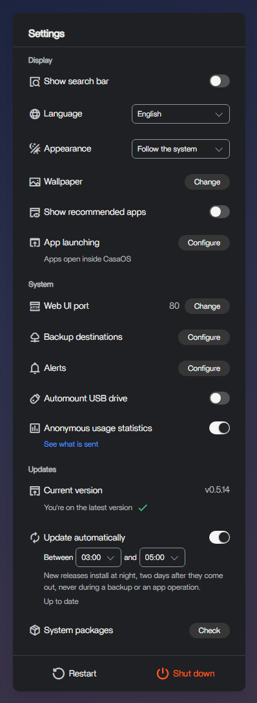
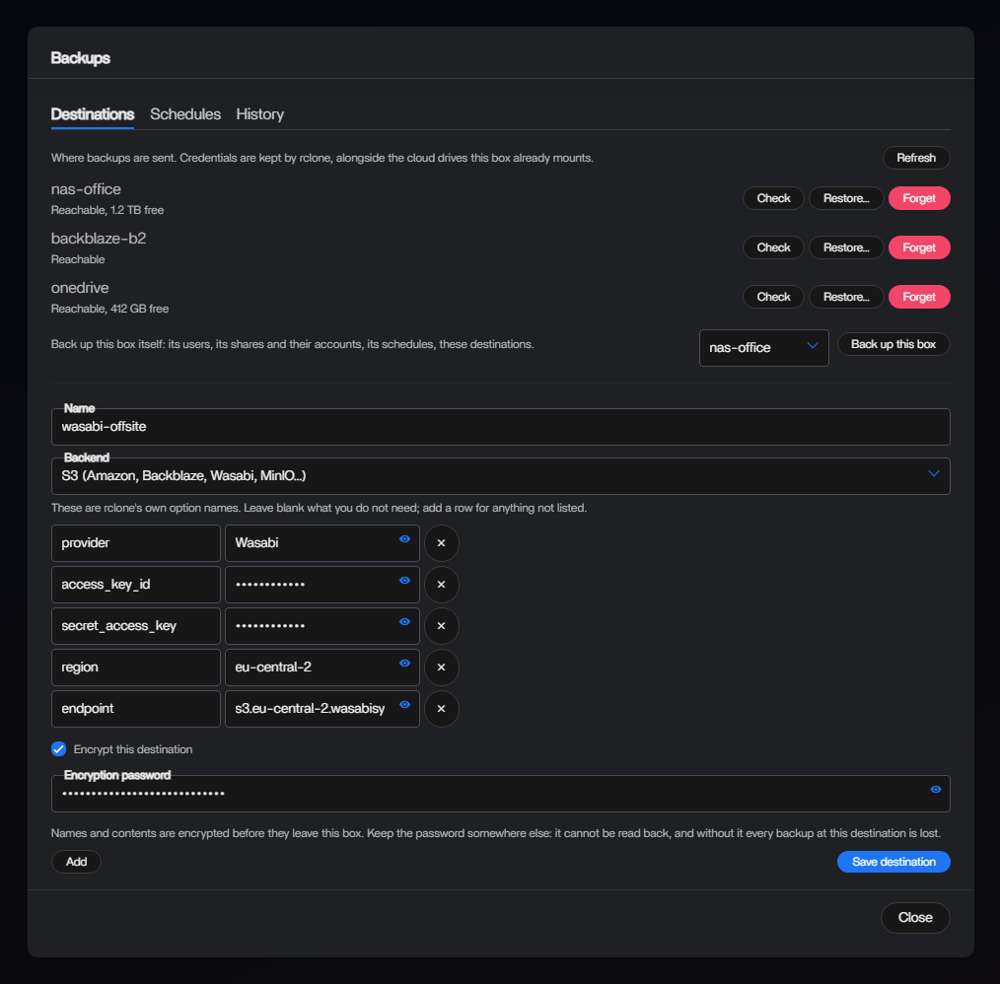
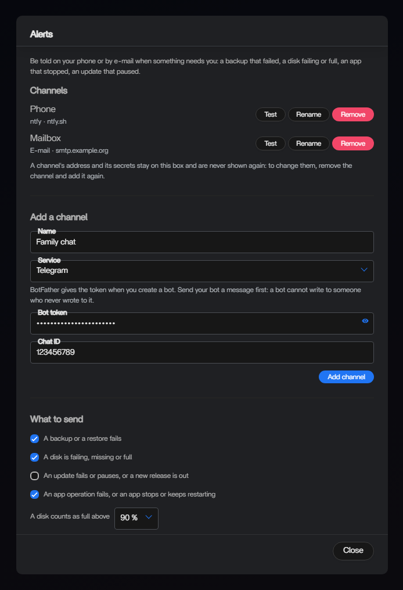

# ReCasaOS

[](https://github.com/ReCasaOS/CasaOS-Install/releases/latest)

> **Not affiliated with IceWhale.**
> This is an independent, community-maintained distribution of CasaOS. It is not produced, endorsed, sponsored, certified or supported by Shanghai IceWhale Technology Limited or by any of the upstream CasaOS maintainers.
>
> CASAOS is a trademark of Shanghai IceWhale Technology Limited. The name is used here only to identify the upstream project that this software is a distribution of, as permitted for referential use; no rights in the CasaOS name or logo are claimed, and no affiliation is implied.
>
> The original project is [IceWhaleTech/CasaOS](https://github.com/IceWhaleTech/CasaOS). Please do not report problems with this distribution to IceWhale — open them at [ReCasaOS/CasaOS/issues](https://github.com/ReCasaOS/CasaOS/issues).

**ReCasaOS** is a maintained release of CasaOS, the personal-cloud OS, after upstream [IceWhaleTech/CasaOS](https://github.com/IceWhaleTech/CasaOS) stopped shipping in 2025. It builds on [alvins82's fork](https://github.com/alvins82/CasaOS-Install), which kept CasaOS installable on Docker 29 and Ubuntu 26, and goes on from there: backups, alerts, apps from git, RAID, virtual machines, statistics, a safer account and network model, and a release pipeline that installs every release from scratch in CI before anyone else does.

This repository holds the installer, the release pipeline and the documentation. The parts of CasaOS live in their own repositories ([Components](#components)). Every change since the fork is in the [changelog](CHANGELOG.md).

<p align="center">
  
  &nbsp;
  
</p>

<sub>The screenshots are the dashboard rendered with sample data.</sub>

## Install

```bash
curl -fsSL https://github.com/ReCasaOS/CasaOS-Install/releases/latest/download/install.sh | sudo bash
```

Architectures: amd64, arm64 and arm/v7, detected at run time. Running the same command on an existing install upgrades it; installs made from alvins82's or IceWhale's installers are migrated the same way, and the in-app updater then follows this distribution's releases. Do not use `get.casaos.io/update` afterwards: it installs IceWhale's frozen component bundle.

**What is tested.** Each release is installed from scratch by CI right after it is published, and exercised end to end (apps, backup and restore, storage, alerts):

- Ubuntu 22.04 on amd64 and arm64, with Docker 28 and with the current Docker that get.docker.com gives a machine that has none;
- Ubuntu 24.04 and 26.04, Debian 12 and Debian 13, in virtual machines (amd64);
- Debian 11 (amd64) is out of support and its security repository still lists packages it no longer serves, so a fresh install would stop at the first one it needs from there. The installer says so and offers to take that repository from archive.debian.org (`--use-debian-archive` answers yes in advance); CI installs it that way.

The installer accepts Docker 20 or later and leaves a Docker that is already there as it is. Other versions are not tested on every release.

**What is verified.** Every package the installer downloads comes from a ReCasaOS release and is checked against a SHA-256 digest before extraction. The digests are written into `install.sh` at release time from the checksums each component publishes, or, for the dashboard and the App Store seed whose releases publish none, computed from the package as published; none is typed by hand. The uninstall script is checked the same way. Docker is the exception: when the box has none, the installer installs it with get.docker.com, apt verifies its packages against Docker's own key, and ReCasaOS neither pins nor checksums them.

## What ReCasaOS adds to CasaOS

### Apps

- **A Compose editor and a `.env` for every app.** Write or paste a compose file and edit it, and its `.env`, in the dashboard. An app whose start fails after a `.env` change goes back to the previous one. `${VAR:-default}` works in a pasted file, and an app installed with its `.env` gets the profiles that `COMPOSE_PROFILES` names.
- **Your own stacks are apps.** A compose file you wrote by hand, or a stack started with `docker compose up` (built from a Dockerfile, with an override file or a relative `env_file`), is listed as an app whose settings and `.env` can be saved.
- **Apps from git.** Deploy an app from a repository, or adopt a folder that already is one. It follows a branch or the highest release tag (optionally within a pattern such as `v2.*`), rebuilds new commits without stopping the running version, and rolls back a version that does not start. A webhook (GitHub, Gitea, Forgejo, GitLab) makes the box check at once instead of waiting for the poll. The compose file and the profiles named by `COMPOSE_FILE` and `COMPOSE_PROFILES` in the app's `.env` are honoured.
- **Updates that say what they will do.** The status dot and the update badge mean what the button will do. *Update every app* lists, image by image, what an update would change and then updates the apps you ticked one after the other. Opt-in automatic updates run at night, two days after a release and never during a backup.

### Backups and restore

- **Apps and the box itself**, to S3, SFTP, FTP, WebDAV, OneDrive, Google Drive, Dropbox or anything else rclone speaks, optionally encrypted, on a schedule with a retention, with a history and a restore. An app that is no longer installed is put back from the compose file its backup holds. The box's own backup carries its users, shares and their accounts, schedules and destinations.
- **A backup that is a consistent copy.** The app is held still for the copy and started again whatever happened; a DNS server such as AdGuard Home or Pi-hole is copied running instead, so the network keeps resolving. A backup asked for while the app is busy waits for its turn, and one that failed in the night is said at the next open of the dashboard.
- **restic, if you want it.** A destination can be switched to a [restic](https://restic.net) repository (*Keep with restic...* in the destinations). Each backup then costs only what changed since the last one, and files keep their owners and permissions, which a plain copy loses. The password is made on the box and shown once: write it down, without it the repository cannot be read. Opt-in per destination; the runs, schedules, retention and restores are the same.

### Alerts

A notification on your phone or an e-mail when a backup fails, a disk fails or fills up, a RAID array loses a disk, an app crashes, a container, a virtual machine or the machine stays above a threshold, or an update pauses (ntfy, Telegram, e-mail, Discord, Gotify, Matrix and more). Nothing is sent until you add a channel.

<p align="center">
  
</p>

### Storage and files

- **Software RAID from the Storage manager.** See the state of an array and be alerted when it loses a disk; repair it (add a blank disk, take a failed one out); create one (RAID 0, 1, 5, 6 or 10, after you type the storage's name again, and with a consent for RAID 0); change a RAID 1 of two or three drives to a RAID 5, then grow its filesystem. `mdadm` is installed for you when it is missing. The commands are proven on real `mdadm` arrays in CI.
- **A trash in Files.** What you delete stays thirty days and can be put back where it was.
- **Shared folders that ask.** Sharing a folder asks who can open it, a guest or an account, and the list tells which, with the shares open to everyone in warning colours. Share accounts are managed from the dashboard, and Time Machine shares are supported.
- **Merged storage** (mergerfs) restored across restarts, SMB discovery over mDNS and Windows Web Service Discovery, renaming a storage volume, accurate usage of nested filesystems. Encrypted disks (a locked LUKS container, a BitLocker volume) are not offered for formatting.
- **Opt-in settings**, mostly contributed by [@ppenguin](https://github.com/ppenguin): a file manager confined to the folders you choose, a first administrator created on the machine, Samba configuration owned by the host, and a mode for hosts whose system image owns updates.

### Virtual machines and statistics

- **Virtual machines**, as the optional `virt` module: create and run machines from the dashboard, upload an ISO or a disk image, console in the browser. Each machine has a tile in the app grid, with its state and the mark of its system, that opens its console.
- **A *Statistics* app.** Processor, memory, network, disk and health of every container (including the ones you started by hand), every virtual machine and the machine itself, live and over the last 7 days, with a common cursor, zoom and a table for every chart. The history is kept in fixed-size files (about 3 MB per item) and survives restarts.
- **Resource alerts.** Each container, virtual machine and the machine has its own rules (processor above 90 % for 10 minutes and memory above 90 % for 5 minutes by default, editable from the app), and a virtual machine that crashes raises one too. They show as a banner, a count on the Statistics icon and a pop-up, and reach your phone under the *resources* category.

### System and updates

- **The in-app updater**, and the *System packages* update in the dashboard. Docker is left out of it and shown on a line of its own: updating Docker restarts it and stops every container until it is back, so it is done only when you confirm, with a list of what will happen. See [Updating Docker](#updating-docker).
- **Modules.** Optional components are installed, updated (with a plan to read first, a backup, and the old version put back on failure) and removed from the Modules window or with `casaos module`. See [Optional modules](#optional-modules).
- **Support of the operating system.** The dashboard says when your Debian or Ubuntu release has run out of security support, checks about 55 points to tell whether the machine could move to the next release, and a wizard moves a Debian 11 machine to Debian 12 (beta, off by default): readiness report, rehearsal, upgrade, restart, check.

### Accounts, network and security

- Passwords are stored with argon2id (each account is upgraded the first time it signs in), and two-factor authentication is available. A session survives a restart.
- Nothing on the message bus without signing in; a refresh token does not open any route; the loopback address is no longer an identity.
- HTTPS on 443 without configuring anything (a self-signed certificate: the browser warns once, and `httpsport=0` turns it off).
- Nothing this distribution installs asks a third party where you are, and the dashboard takes no package from IceWhale.
- Moving files can no longer delete them, a leaked download link no longer gives write access, and cloud tokens stay out of the logs.
- Every service is built with a supported Go and the dependencies with known vulnerabilities are updated or removed.

### The dashboard

Moved to Vue 3, with a dark theme, a complete French translation, a settings panel that is grouped and compact, dialogs that share one layout, and a home page that fits a phone. System apps (App Store, Files, Virtual Machines, Statistics) carry a small gear mark so they are not taken for apps you installed.

## Optional modules

Some components are optional: they live in a repository of their own, ship their own releases and are installed only when you ask. A box that does not ask downloads and runs none of it. [docs/modules.md](docs/modules.md) is the contract for a module's author and says what is checked before anything is written to your box.

```bash
curl -fsSL https://github.com/ReCasaOS/CasaOS-Install/releases/latest/download/install.sh | sudo bash -s -- --module <name>
```

- **One module is offered: `virt`** (virtual machines, from [CasaOS-VirtManagement](https://github.com/ReCasaOS/CasaOS-VirtManagement)). It is in the *core* tier: maintained here and installed, run, updated and removed in CI on real guests (Debian 12, Ubuntu 22.04 and Ubuntu 24.04, with libvirt's test driver) before a release carries it. Install it from the Modules window, with `casaos module install virt`, or with `--module virt`.
- **The catalogue is pinned.** Every release carries a catalogue of the modules it can install, pinned by a SHA-256 written into `install.sh` like the packages. A module that is not in it cannot be installed, and one that cannot be installed is reported with the step that failed and why, without failing the install of ReCasaOS. `sudo casaos module remove <name>` cleans up what a failed install left.
- **Installed modules follow the release.** When ReCasaOS is updated, every installed module that the new release's catalogue has at a later version is updated too, so a new dashboard never runs beside a module built for the old one. Nothing is installed that was not, and no module goes back to an earlier version. A module whose update fails is put back at its old version, keeps running, and can be retried from the Modules window. Run the installer by hand with `--no-module-update`, or with `RECASAOS_MODULE_UPDATE=0` on the install line, to leave the modules where they are; the dashboard's update and the automatic updates have no such opt-out. They hand the module updates to `casaos-update-modules.service`, which waits up to 10 minutes for the update to finish and adds its lines to `/var/log/casaos/upgrade.log`.

## Updating Docker

ReCasaOS does not update Docker for you, and the installer never changes a Docker that is already there. Updating it restarts the Docker daemon, and that stops every container until it is back: apps with a restart policy of `always` or `unless-stopped` start again on their own, the others stay stopped. Do it when that suits you, and keep the output of `docker ps` first.

If your Docker came from Docker's own repository, which is what the installer sets up on Debian and Ubuntu, this updates it within its major version:

```bash
sudo apt-get update && sudo apt-get install --only-upgrade docker-ce docker-ce-cli containerd.io docker-buildx-plugin docker-compose-plugin
```

A new major version (28 to 29) is a bigger step: read Docker's release notes first. A Docker from your distribution's own packages (`docker.io`) or from snap is updated with the tools of that system.

Since v0.5.19 the dashboard's *System packages* update leaves Docker out and shows it on a line of its own, with the command above for the packages it lists. Before, it ran a plain `apt-get upgrade`, which included Docker's packages when Docker's repository was configured, and so could restart Docker and move it to a newer version.

## Anonymous statistics

A ReCasaOS box sends anonymous statistics, so that the maintainers know how many boxes are running, which release they run, how fast they update after a release, and on what hardware: what GitHub's download counters cannot tell. They are **on by default**, and they say so: at the end of every install and upgrade, in a notice the dashboard shows once, and here. Any one of the three ways below turns them off.

**Who receives them.** [PostHog](https://posthog.com) Cloud, in its EU region. The CasaOS core posts them to `https://eu.i.posthog.com/i/v0/e/`; the dashboard sends nothing.

**When.** Two events: `heartbeat`, at most once every three hours, which counts the boxes running, and `version_changed`, once after an install or an upgrade, which measures how fast boxes update. A failed send waits for the next hourly check; nothing is queued.

**Which box.** A random UUID, made on first use and kept in `/var/lib/casaos/telemetry.json` (root only). It derives from nothing on the machine; a reinstall that removes `/var/lib/casaos` makes a new one.

**What is sent.** These properties, on both events, `previous_distribution` on `version_changed` only. *See what is sent*, in the dashboard's settings, shows the values this box would send, built by the code that sends them.

<details>
<summary>The properties, one by one</summary>

| Property | Example | Source |
|---|---|---|
| `distribution` | `v0.5.0` | `/var/lib/casaos/fork-release`, trimmed; `unknown` if absent |
| `previous_distribution` | `v0.4.99`, `new`, `upstream` | `/var/lib/casaos/upgraded-from`, written by the installer: the release it replaced, `new` on a machine without CasaOS, `upstream` on a box coming from IceWhale's CasaOS |
| `core` | `v0.4.59` | `"v" + common.VERSION` |
| `arch` | `amd64`, `arm64`, `arm-7` | `runtime.GOARCH`, plus `GOARM` from the build info for `arm` |
| `os` | `ubuntu 24.04`, `debian 12`, `arch` | `/etc/os-release`: `ID` and `VERSION_ID` (ID alone when there is no VERSION_ID); `unknown` if unreadable |
| `kernel` | `6.8` | `uname` release, major.minor |
| `virtualization` | `none`, `kvm`, `lxc`, `wsl`, `unknown` | `systemd-detect-virt` output; `unknown` if it cannot run |
| `model` | `Raspberry Pi 5 Model B Rev 1.0`, `ZimaBoard` | `/proc/device-tree/model`, else `/sys/class/dmi/id/product_name`; NUL and spaces trimmed, 64 characters max; `unknown` if empty or a known placeholder (`To Be Filled By O.E.M.`, `System Product Name`, `Default string`, `Not Specified`) |
| `docker` | `28.3.1` | `GET /version` on `/var/run/docker.sock`, field `Version`; `unknown` if unavailable |
| `cpu_cores` | `4` | `runtime.NumCPU()` |
| `ram_gb` | `"8"` (a string, because of `128+`) | `MemTotal` from `/proc/meminfo`, rounded to the nearest of 1, 2, 4, 8, 16, 32, 64, then `128+` |
| `disks` | `3` | entries of `/sys/block` whose resolved path is not under `/sys/devices/virtual/`, excluding `sr*` and `mmcblk*boot*` |
| `storage_tb` | `4-8` | sum of those disks' sizes (`/sys/block/<d>/size` × 512 bytes), bucketed: `<0.5`, `0.5-1`, `1-2`, `2-4`, `4-8`, `8-16`, `16-32`, `32+` (TB, 10^12 bytes) |
| `raid` | `true` | `/proc/mdstat` lists an active `md` array |

</details>

Every event also carries `$process_person_profile: false`, so PostHog makes no person profile, and `$lib: "recasaos-core"`. PostHog derives the **country** from the address the event comes from: the project discards that address, and keeps the country and the continent only, every finer location being dropped before anything is stored.

**Never sent:** IP address (discarded by the project setting), hostname, MAC address, serial numbers, disk names, labels or paths, installed apps, user accounts, anything about the local network.

### Turning them off

Any one of these; an upgrade never turns them back on.

- **With the installer**: `--no-telemetry`, or `RECASAOS_TELEMETRY=0`, on an install or on an upgrade.

  ```bash
  curl -fsSL https://github.com/ReCasaOS/CasaOS-Install/releases/latest/download/install.sh | sudo bash -s -- --no-telemetry
  curl -fsSL https://github.com/ReCasaOS/CasaOS-Install/releases/latest/download/install.sh | sudo RECASAOS_TELEMETRY=0 bash
  ```

- **In the dashboard**: the *Anonymous usage statistics* switch in the settings. It takes effect at once.
- **By hand**: stop the core (`sudo systemctl stop casaos`), set `"enabled": false` in `/var/lib/casaos/telemetry.json` (or create the file holding `{"enabled": false}` if it is not there yet), and start it again (`sudo systemctl start casaos`).

## Components

Each component is released from its own repository. The versions a release pins are in [`release/components.env`](release/components.env) and in the `components.lock` asset of that release.

| Component | What it is |
|---|---|
| [CasaOS](https://github.com/ReCasaOS/CasaOS) | The core: files, storage, shares, the system |
| [CasaOS-UI](https://github.com/ReCasaOS/CasaOS-UI) | The dashboard |
| [CasaOS-AppManagement](https://github.com/ReCasaOS/CasaOS-AppManagement) | Apps, Compose, git deployments, backups, statistics |
| [CasaOS-Gateway](https://github.com/ReCasaOS/CasaOS-Gateway) | The front door: routing, HTTPS |
| [CasaOS-UserService](https://github.com/ReCasaOS/CasaOS-UserService) | Accounts and sessions |
| [CasaOS-MessageBus](https://github.com/ReCasaOS/CasaOS-MessageBus) | Events between the services |
| [CasaOS-LocalStorage](https://github.com/ReCasaOS/CasaOS-LocalStorage) | Disks, storage volumes, RAID |
| [CasaOS-VirtManagement](https://github.com/ReCasaOS/CasaOS-VirtManagement) | The optional `virt` module |
| [rclone](https://github.com/rclone/rclone) | The transport of backups and cloud drives |
| [restic](https://github.com/restic/restic) | The repositories of backups kept with restic |

The installer downloads every package from a ReCasaOS release. The App Store seed, the snapshot a new box needs for its store to be populated before the first refresh, is IceWhale's, mirrored into our release at release time and pinned by the digest of the copy we serve; nothing about the catalogue changes, AppManagement keeps polling IceWhale's live store feed and IceWhale keeps curating it. IceWhale's CasaOS-CLI is no longer installed: nothing in the distribution ever called it.

## How a release is made

Nothing is built on a workstation.

1. Each component is tagged and its own workflow publishes tarballs and, except the dashboard, a `checksums.txt`.
2. Those tags and commits are pinned in [`release/components.env`](release/components.env).
3. This repository is tagged. Its workflow checks out the six components at the pinned commits, packages their setup scripts as the compatibility overlay, fetches the published digest of every package that has one, mirrors the App Store seed, computes the digest of the dashboard and of the mirrored seed from the packages themselves and of the uninstall script it ships, writes every tag and digest into `install.sh`, and publishes the result. It refuses to produce an installer with a placeholder left unfilled, and to build a module catalogue for a release whose core is older than the first one that has `casaos module`, or that does not read the catalogue it is built with when it is built and run.

`scripts/build-release-bundle.sh` is that step. It can be run locally: `WORKSPACE_ROOT` names the directory holding the six component checkouts at the pinned commits, `CHECKSUMS_BASE_URL` is where the six components' `checksums.txt` and the dashboard tarball are downloaded from, and `UPSTREAM_BASE_URL` is where the App Store seed tarball is downloaded from. Both default to GitHub; a `file://` URL pointing at a local tree laid out as `<repo>/releases/download/<tag>/` exercises the whole chain before any release exists.

## How it is developed

A large part of the code, the tests and the documentation of this distribution is written with an AI coding assistant. The maintainer runs the result on their own machines, decides what is merged and tags every release; nothing is published automatically.

Who or what wrote a line says little about whether it works, so what stands between a change and your machine does not depend on it:

- each release is installed from its published bundle and used end to end by CI, on amd64 and arm64;
- every package is verified against a SHA-256 digest before extraction, and the release workflow refuses to produce an installer with a placeholder left in it;
- the components' CI builds them and runs their tests.

If something in the code looks wrong, please [open an issue](https://github.com/ReCasaOS/CasaOS/issues): reading it is the review this project most needs.

## Uninstall

```bash
sudo casaos-uninstall
```

If optional modules are installed, the uninstaller first removes each one with `casaos module remove <name> --yes` and shows what it says; a module that cannot be removed is reported with the step and the reason, and the uninstall goes on. **What stays on purpose:** the packages the module needed and its data (for the virtual machines module, `/DATA/VM`). The uninstaller prints, at its end, the commands that purge them by hand, and does not run them.

## History

This distribution started from alvins82's v0.4.39. His release notes are kept here because his work is what made CasaOS installable again on current systems:

<details>
<summary>alvins82's fork changelog (v0.4.26 – v0.4.39)</summary>

- **2026-08-20 — [v0.4.39](https://github.com/alvins82/CasaOS-Install/releases/tag/v0.4.39):** No functional code changes; re-pins components to the commits merged into fork `main`: CasaOS LocalStorage `v0.4.28` (republish after [PR #10](https://github.com/alvins82/CasaOS-LocalStorage/pull/10) merge, byte-identical sources to v0.4.27) and CasaOS AppManagement `v0.4.19` at the merge commit (first tagged release of the AppManagement fork). Core packages and the v0.4.39 overlay are republished.
- **2026-08-20 — [v0.4.38](https://github.com/alvins82/CasaOS-Install/releases/tag/v0.4.38):** Supersedes v0.4.37 by fixing a crash loop found in the first reboot test: the AppManagement recovery sweep called `SetStatus` with a cron context carrying no event properties, panicking on a nil map. Bumps CasaOS AppManagement to `v0.4.19` (commit `bd428f9`), which attaches event properties in the sweep and adds a defensive guard in `SetStatus`. Core packages are republished unchanged.
- **2026-08-20 — [v0.4.37](https://github.com/alvins82/CasaOS-Install/releases/tag/v0.4.37):** Published the full fork bundle with CasaOS LocalStorage `v0.4.27`, which restores all persisted merge mounts during the before-docker init step, and AppManagement `v0.4.18`, which starts apps that were abandoned because storage was not ready at boot while respecting apps the user stopped. Core packages are republished unchanged from v0.4.36.
- **2026-08-20 — [v0.4.36](https://github.com/alvins82/CasaOS-Install/releases/tag/v0.4.36):** Published the full fork bundle with CasaOS LocalStorage `v0.4.26`, which keeps restoring merge mounts until their source disks appear, fails loudly with the offending entries when a merge mount point is not empty, and surfaces the last restore failure in the merge status endpoint. Core and AppManagement packages are republished unchanged from v0.4.35.
- **2026-08-15 — [v0.4.35](https://github.com/alvins82/CasaOS-Install/releases/tag/v0.4.35):** Supersedes v0.4.34 with exact 64-character SHA-256 values for every architecture, including the amd64 and arm/v7 AppManagement packages.
- **2026-08-15 — [v0.4.34](https://github.com/alvins82/CasaOS-Install/releases/tag/v0.4.34):** Corrected the SHA-256 values used to verify the fork packages and republished the compatibility overlay with the matching release marker. This fixes upgrades that stopped during package verification after v0.4.33.
- **2026-08-15 — [v0.4.33](https://github.com/alvins82/CasaOS-Install/releases/tag/v0.4.33):** Published the full fork bundle with CasaOS core `v0.4.28` and CasaOS UI `v0.4.30`. It fixes shutdown and restart handling by using explicit systemd power actions, keeping the UI from reloading after shutdown, and surfacing power-command failures. PRs: [CasaOS #26](https://github.com/alvins82/CasaOS/pull/26), [CasaOS-UI #15](https://github.com/alvins82/CasaOS-UI/pull/15).
- **2026-08-14 — [v0.4.32](https://github.com/alvins82/CasaOS-Install/releases/tag/v0.4.32):** Published the full fork bundle with CasaOS LocalStorage `v0.4.25`, which restores persisted mergerfs mounts before creating default `/DATA` directories so updates and restarts retain the configured merged storage. PR: [CasaOS-LocalStorage #9](https://github.com/alvins82/CasaOS-LocalStorage/pull/9).
- **2026-08-14 — [v0.4.31](https://github.com/alvins82/CasaOS-Install/releases/tag/v0.4.31):** Published the full fork bundle with CasaOS core `v0.4.27`, CasaOS UI `v0.4.29`, and CasaOS LocalStorage `v0.4.24`. It adds host-level SMB zeroconf discovery through mDNS/DNS-SD and Windows Web Service Discovery, with optional Avahi/wsdd dependencies handled without blocking installation or upgrades.
- **2026-08-13 — [v0.4.30](https://github.com/alvins82/CasaOS-Install/releases/tag/v0.4.30):** Published the full fork bundle with CasaOS core `v0.4.26`, CasaOS UI `v0.4.29`, and CasaOS LocalStorage `v0.4.24`. It creates missing `Documents`, `Downloads`, `Gallery`, and `Media` directories in external merged storage while preserving system `AppData` behavior. PR: [CasaOS-LocalStorage #7](https://github.com/alvins82/CasaOS-LocalStorage/pull/7).
- **2026-08-13 — [v0.4.29](https://github.com/alvins82/CasaOS-Install/releases/tag/v0.4.29):** Published the full fork bundle with CasaOS core `v0.4.26`, CasaOS UI `v0.4.29`, and CasaOS LocalStorage `v0.4.23`. It includes the Files App Store-style dialog, one-surface dashboard scrolling, corrected hidden-files icons, storage-volume rename controls, and the matching LocalStorage rename API. PRs: [CasaOS #21](https://github.com/alvins82/CasaOS/pull/21), [CasaOS-UI #11](https://github.com/alvins82/CasaOS-UI/pull/11), [CasaOS-UI #12](https://github.com/alvins82/CasaOS-UI/pull/12), [CasaOS-UI #13](https://github.com/alvins82/CasaOS-UI/pull/13), [CasaOS-UI #14](https://github.com/alvins82/CasaOS-UI/pull/14), [CasaOS-LocalStorage #6](https://github.com/alvins82/CasaOS-LocalStorage/pull/6).
- **2026-08-13 — [v0.4.26](https://github.com/alvins82/CasaOS-Install/releases/tag/v0.4.26):** Added in-dashboard system package updates, accurate nested filesystem usage and disk ownership, and the persistent widget search setting. This bundle pins CasaOS core `v0.4.25`, CasaOS UI `v0.4.28`, and CasaOS LocalStorage `v0.4.22`. PRs: [CasaOS #16](https://github.com/alvins82/CasaOS/pull/16), [CasaOS #17](https://github.com/alvins82/CasaOS/pull/17), [CasaOS #18](https://github.com/alvins82/CasaOS/pull/18), [CasaOS #19](https://github.com/alvins82/CasaOS/pull/19), [CasaOS #20](https://github.com/alvins82/CasaOS/pull/20), [CasaOS-UI #8](https://github.com/alvins82/CasaOS-UI/pull/8), [CasaOS-UI #9](https://github.com/alvins82/CasaOS-UI/pull/9), [CasaOS-UI #10](https://github.com/alvins82/CasaOS-UI/pull/10), [CasaOS-LocalStorage #5](https://github.com/alvins82/CasaOS-LocalStorage/pull/5).

</details>

## Licence

The CasaOS components are published under the Apache License 2.0 and keep their upstream copyright notices. The dashboard repository has never carried a licence file of its own; it is distributed here as part of CasaOS releases, as upstream distributed it.
